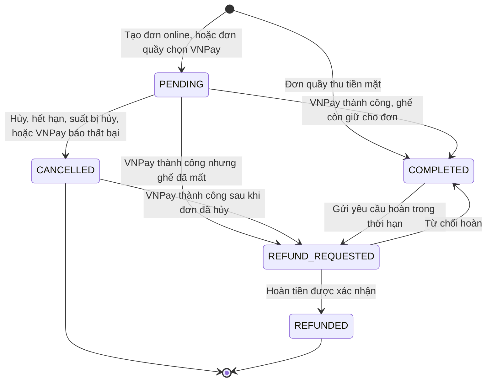
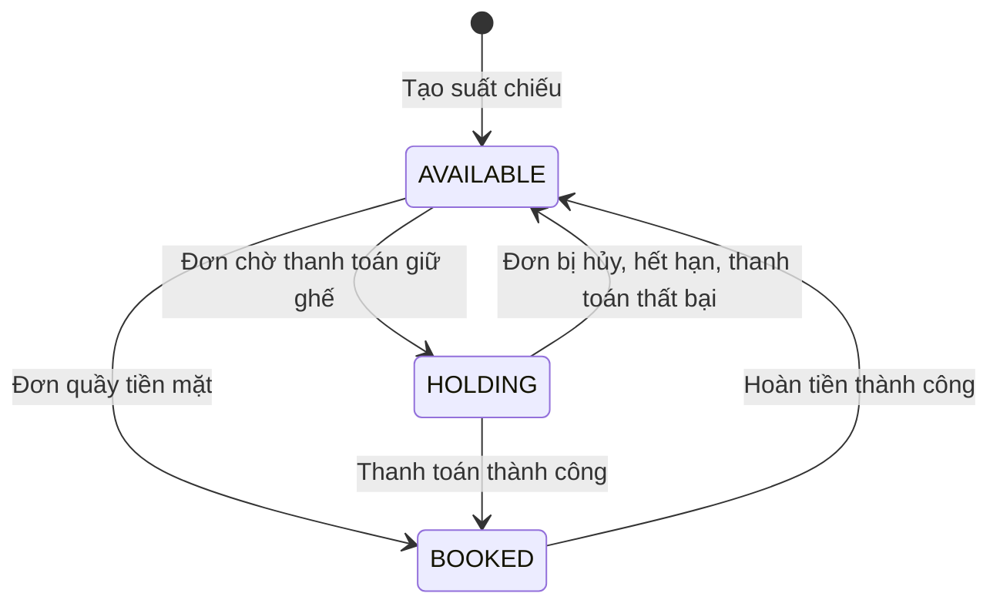
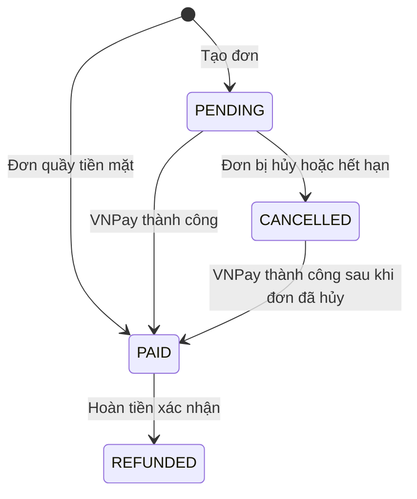
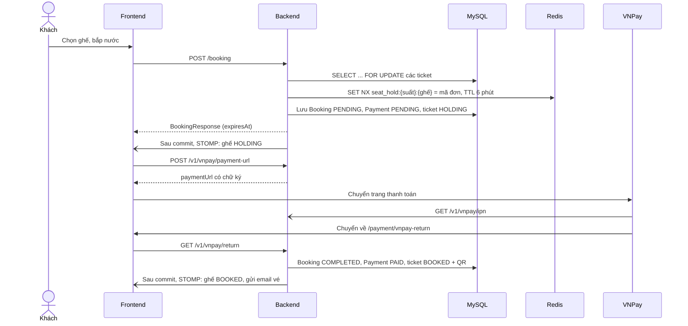

# Vòng đời đơn đặt vé

> Đối chiếu mã nguồn ngày 2026-11-25, nhánh `fix/backend-review-cleanup` (tách từ commit `7105c25`).

File này mô tả một đơn từ lúc có suất chiếu tới khi khách vào phòng. Phần tiền (VNPay, hoàn tiền) nằm trong [payment-refund.md](payment-refund.md). Các con số như thời gian giữ ghế là giá trị mặc định, ADMIN đổi được ở [tham số nghiệp vụ](overview.md#tham-số-nghiệp-vụ).

## Trước khi đặt: suất chiếu và vé

- MANAGER (chi nhánh mình) hoặc ADMIN tạo suất chiếu cho một phòng `ACTIVE`, với giờ bắt đầu, giờ kết thúc, định dạng chiếu và giá vé.
- Hai suất cùng phòng phải cách nhau ít nhất 15 phút. Backend kiểm tra trùng giờ trên khoảng `[start − 15 phút, end + 15 phút]`.
- Khi lưu suất, `TicketService.createTicket` tạo sẵn một `Ticket` cho mỗi ghế của phòng, trạng thái `AVAILABLE`, giá bằng `ticketPrice` của suất. Mọi ghế trong một suất có cùng giá, kể cả ghế `VIP` và `COUPLE`.
- Đổi giá suất chỉ được khi mọi vé của suất còn `AVAILABLE` và chưa gắn đơn. Ngược lại backend trả `SHOWTIME_PRICE_LOCKED`.
- Xóa suất chỉ ADMIN làm được và chỉ khi suất chưa có đơn (`SHOWTIME_HAS_BOOKINGS`). Suất đã có đơn thì chuyển trạng thái sang `CANCELLED`.
- Khi suất chuyển sang `CANCELLED`, mọi đơn `PENDING` của suất bị hủy và trả ghế, bắp nước, lượt khuyến mãi trong cùng transaction. Đơn đã thanh toán giữ nguyên. Từ đó backend không tạo URL VNPay cho đơn của suất (`SHOWTIME_CANCELLED`), và tiền VNPay báo về cho suất này đi vào [thanh toán trễ](payment-refund.md#thanh-toán-trễ) thay vì xuất vé.
- Job chạy mỗi 5 phút chuyển suất `OPEN` đã qua giờ kết thúc sang `CLOSED`.

Một suất **còn bán được** khi đủ các điều kiện: suất `OPEN`, phim `isPublic = true`, phòng `ACTIVE`, chi nhánh `ACTIVE`, và thời điểm hiện tại còn trước giờ chiếu. Riêng bán tại quầy được bán tiếp tới 15 phút sau giờ chiếu cho khách đến muộn. Suất không đạt điều kiện bị báo `SHOWTIME_NOT_FOUND`.

## Trạng thái

### Booking

| Từ | Sang | Ai hoặc cái gì kích hoạt | Điều kiện |
| --- | --- | --- | --- |
| — | `PENDING` | Khách (`POST /booking`), nhân viên chọn VNPay ở quầy | Xem [kiểm tra khi tạo đơn](#kiểm-tra-khi-tạo-đơn-online). |
| — | `COMPLETED` | Nhân viên thu tiền mặt (`POST /booking/staff`, `paymentMethod` là `CASH` hoặc bỏ trống) | Như trên, thêm quyền bán tại chi nhánh. |
| `PENDING` | `COMPLETED` | Callback VNPay thành công | Payment còn `PENDING` và mọi vé của đơn còn `HOLDING` cho đúng đơn này. Callback tới sau `expiresAt` vẫn được chấp nhận nếu ghế còn giữ. |
| `PENDING` | `CANCELLED` | Chủ đơn, STAFF cùng chi nhánh hoặc ADMIN hủy; job dọn hết hạn; callback VNPay thất bại; suất chuyển sang `CANCELLED` | Chỉ hủy được đơn `PENDING`. |
| `PENDING`, `CANCELLED` | `REFUND_REQUESTED` | Callback VNPay thành công khi đơn không còn ghế hoặc suất đã bị hủy | Tiền đã bị trừ nên đơn được đưa vào hàng chờ hoàn. Xem [thanh toán trễ](payment-refund.md#thanh-toán-trễ). |
| `COMPLETED` | `REFUND_REQUESTED` | Chủ đơn, hoặc nhân viên gửi thay khách cho đơn tại quầy | Xem [điều kiện yêu cầu hoàn](payment-refund.md#yêu-cầu-hoàn-tiền). |
| `REFUND_REQUESTED` | `COMPLETED` | ADMIN hoặc MANAGER từ chối | Không có lần hoàn VNPay nào đang `PROCESSING` hoặc `UNKNOWN`. |
| `REFUND_REQUESTED` | `REFUNDED` | ADMIN hoặc MANAGER duyệt và cổng xác nhận (hoặc xác nhận đã trả tiền mặt) | Chưa có vé nào được check-in. |

`EXPIRED` vẫn có trong enum và ràng buộc CHECK để đọc dữ liệu cũ, nhưng code hiện tại chuyển đơn hết hạn sang `CANCELLED`.

### Ticket

Vé chỉ có ba trạng thái. Check-in không phải trạng thái riêng mà là vé `BOOKED` có `checkedInAt` khác null. Khi trả ghế, backend gỡ vé khỏi đơn, xóa mã QR và thông tin check-in. Vé `BOOKED` được cấp mã QR dạng `CINEMAHUB|BOOKING=<mã đơn>|TICKET=<id vé>|SEAT=<mã ghế>`.

### Payment

Mỗi đơn có đúng một `Payment`. Trạng thái của lần hoàn tiền qua cổng (`refundGatewayStatus`) là một trường riêng, mô tả trong [payment-refund.md](payment-refund.md#trạng-thái-lần-hoàn-qua-vnpay).

## Đặt vé online

### Kiểm tra khi tạo đơn online

`BookingCheckoutService.createBooking` chạy trong một transaction, theo thứ tự:

1. Người gọi đã đăng nhập.
2. Số ghế không vượt `booking.maxTicketsPerTransaction` (mặc định 8), nếu vượt trả `MAX_TICKET_PER_TRANSACTION`.
3. Suất chiếu còn bán được.
4. Khách có ít hơn `booking.maxPendingPerUser` (mặc định 2) đơn `PENDING` còn hạn, nếu không trả `BOOKING_PENDING_LIMIT`. Giới hạn này ngăn một tài khoản giữ hết ghế của suất.
5. Danh sách ghế không trùng, không null. Các ticket được khóa bằng `findSeatsForUpdate` theo thứ tự id để tránh deadlock, và tất cả phải `AVAILABLE`, nếu không trả `TICKET_NOT_AVAILABLE`.
6. Bắp nước: mỗi món xuất hiện một lần, số lượng từ 1 tới 50, món còn `active`, và thuộc đúng chi nhánh của suất hoặc dùng chung cho mọi chi nhánh (`branchId` null). Backend trừ tồn ngay. Xem [bắp nước](#bắp-nước-và-tồn-kho).
7. Tính giá ở server, áp mã khuyến mãi nếu có và giữ một lượt dùng. Xem [promotion-membership.md](promotion-membership.md).
8. Lấy khóa Redis cho từng ghế. Nếu một ghế đã có khóa, trả `TICKET_NOT_AVAILABLE` và nhả các khóa vừa lấy.
9. Lưu `Booking` `PENDING` với `expiresAt = now + booking.holdMinutes`, `Payment` `PENDING`, gắn ticket `HOLDING`, lưu `BookingFood`.
10. Sau khi commit, phát trạng thái ghế qua WebSocket.

Lỗi ở bất kỳ bước nào làm rollback toàn bộ: tồn bắp nước, lượt khuyến mãi và ticket trở về như cũ, khóa Redis đã lấy được nhả.

### Giữ ghế

Một ghế đang giữ cho đơn được ghi ở hai nơi:

| Nơi | Giá trị | Vai trò |
| --- | --- | --- |
| MySQL | `tickets.ticket_status = 'HOLDING'`, `booking_id` trỏ tới đơn | Nguồn chính. Khóa dòng khi tạo đơn ngăn hai request cùng lấy một ghế. |
| Redis | `seat_hold:{showtimeId}:{seatId}` = mã đơn, TTL bằng `booking.holdMinutes` | Cho biết ghế đang có người giữ để sơ đồ ghế hiển thị đúng. TTL là giới hạn trên nếu job dọn dẹp chậm hoặc Redis mất kết nối. |

Khóa Redis chỉ được xóa bởi đúng đơn đã tạo nó (Lua compare-and-delete), và chỉ sau khi transaction commit. Lý do chọn cách này nằm trong [ADR-0002](../08-decisions/0002-seat-hold-redis-and-db-lock.md).

Sơ đồ ghế (`GET /ticket/showtime/{id}`) trả `displayStatus`: `BOOKED` nếu vé đã bán, `HOLDING` nếu có khóa Redis, còn lại lấy theo trạng thái trong DB. API này cố ý không cache.

### Hủy và hết hạn

- Chủ đơn, STAFF cùng chi nhánh hoặc ADMIN hủy được đơn `PENDING` bằng `DELETE /booking/{id}`. Đơn ở trạng thái khác trả `BOOKING_CANNOT_CANCEL`.
- `BookingCleanupJob` chạy mỗi 120 giây, tìm đơn `PENDING` có `expiresAt` đã qua. Mỗi đơn được xử lý trong một transaction riêng: khóa đơn, kiểm tra lại trạng thái và hạn, rồi mới hủy. Một đơn lỗi chỉ được ghi log, không chặn các đơn khác.
- Đơn có thể còn `PENDING` tối đa khoảng 2 phút sau `expiresAt` trước khi job chạy. Trong khoảng này callback VNPay thành công vẫn xuất vé nếu ghế còn giữ cho đơn.

Khi hủy hoặc hết hạn, Booking và Payment chuyển `CANCELLED`, và `BookingReleaseService.releaseUnpaid` trả lại mọi tài nguyên: vé về `AVAILABLE`, cộng lại tồn bắp nước, trả lượt khuyến mãi đã giữ, nhả khóa Redis và phát trạng thái ghế sau commit. `BookingReleaseService` là nơi duy nhất trả tài nguyên của đơn.

## Bán tại quầy

Khác biệt so với đơn online:

| Khía cạnh | Online | Tại quầy |
| --- | --- | --- |
| Người tạo | Khách đăng nhập | ADMIN, hoặc STAFF của chi nhánh có suất chiếu |
| Thời hạn bán | Trước giờ chiếu | Tới 15 phút sau giờ chiếu |
| Chủ đơn | Người đặt | Khách tìm theo SĐT/email, hoặc tài khoản khách vãng lai tạo mới |
| Người bán | `staffUser = null` | `staffUser` là nhân viên, lưu ở cột `booked_staff` |
| Giới hạn đơn chờ mỗi khách | Có | Không |
| Kiểm tra khóa Redis khi chọn ghế | Qua `SET NX` | Kiểm tra thêm khóa đang có trước khi khóa DB, vì khách online có thể đang giữ ghế |
| Tiền mặt | — | `COMPLETED`, `PAID`, vé `BOOKED` và QR ngay, không lấy khóa Redis |
| VNPay | Chuyển trang thanh toán | Đơn `PENDING`, ghế giữ ở Redis như đơn online. Màn quầy hiện QR liên kết thanh toán và hỏi lại trạng thái đơn mỗi 3 giây |
| Nhật ký | — | Ghi `STAFF_BOOKING_CREATED` |

Không có nghiệp vụ mở ca trước khi bán.

### Xác định khách tại quầy

`StaffCustomerService` chuẩn hóa SĐT (10 số, bắt đầu bằng 0, nhận dạng `+84`) và email, rồi tìm tài khoản trùng:

- Không trùng: tạo tài khoản USER mới có `username` dạng `guest_<sđt hoặc email>` và mật khẩu ngẫu nhiên. Khách không đăng nhập được bằng tài khoản này.
- Trùng một tài khoản: request phải gửi `confirmedCustomerId` đúng với ID mà `GET /staff/customers/lookup` trả về (thông tin đã che bớt), nếu không trả `CUSTOMER_CONFIRMATION_REQUIRED`. Nhân viên bấm "Đúng khách này" trên giao diện để xác nhận.
- Tài khoản trùng không phải USER hoặc không còn ACTIVE: `CUSTOMER_NOT_ELIGIBLE`.
- SĐT và email thuộc hai tài khoản khác nhau: `CUSTOMER_CONTACT_CONFLICT`.

Mục đích là không gắn đơn, chi tiêu và email vé có mã QR vào tài khoản của người khác.

Ở màn bán vé, đơn chỉ được tạo khi nhân viên thu tiền hoặc tạo QR VNPay. Trong lúc nhập thông tin khách, ghế **chưa** được giữ. Nếu WebSocket báo một ghế đang chọn vừa bị đặt ở nơi khác, màn hình bỏ ghế đó và cảnh báo.

## Bắp nước và tồn kho

- Món có `branchId` null bán ở mọi chi nhánh, món có `branchId` chỉ bán ở chi nhánh đó.
- `stockQuantity` null nghĩa là không giới hạn. Ngược lại, tồn bị trừ ngay khi tạo đơn và cộng lại khi đơn bị hủy hoặc hết hạn. Không đủ tồn trả `FOOD_OUT_OF_STOCK`.
- Khi tồn vừa giảm tới `lowStockThreshold` (mặc định 10) hoặc về 0, hệ thống gửi thông báo `LOW_STOCK` cho ADMIN và MANAGER của chi nhánh.
- Hoàn tiền không cộng lại tồn, vì hệ thống không biết bắp nước đã được trả vật lý hay chưa.
- `BookingFood` chụp đơn giá và thành tiền lúc đặt, nên đổi giá món sau đó không làm đổi giá đơn cũ.

## Check-in

Nhân viên quét QR bằng camera, tải ảnh QR (`POST /ticket/check-in/qr-image`, field `qrImage`), hoặc nhập mã (`POST /ticket/check-in`).

| Mã nhập vào | Kết quả |
| --- | --- |
| Chuỗi QR đầy đủ của một vé | Soát vé đó. Chuỗi phải khớp đúng mã QR đã cấp. |
| Mã đơn `BK-...` | Soát mọi vé của đơn. |
| Chỉ gồm chữ số (ID vé) | Từ chối với `CHECKIN_CODE_NOT_ACCEPTED`. ID vé tăng dần, gõ nhầm một chữ số sẽ soát mất vé của khách khác. |

Vé hợp lệ khi đơn `COMPLETED`, payment `PAID` và vé `BOOKED`. Lần soát đầu còn phải đúng khung giờ:

- Từ 60 phút trước giờ chiếu (`CHECKIN_TOO_EARLY` nếu sớm hơn).
- Tới khi suất kết thúc (`CHECKIN_SHOWTIME_ENDED`).
- Suất không bị hủy (`CHECKIN_SHOWTIME_CANCELLED`).

STAFF và MANAGER chỉ soát vé của chi nhánh mình (`TICKET_WRONG_BRANCH`, HTTP 403). Backend ghi `checkedInAt`, `checkedInBy` và nhật ký `TICKET_CHECKED_IN`. Quét lại vé đã soát trả `alreadyCheckedIn = true` và giữ thông tin lần đầu, kể cả sau khi suất đã kết thúc. Đơn đã có vé check-in không thể hoàn tiền.

## Hạn chế đã biết

- Loại ghế chưa ảnh hưởng giá. `TicketResponse` không trả `seatType`, nên sơ đồ ghế ở trang khách và màn quầy hiện mọi ghế như ghế thường dù phòng có ghế `VIP` hoặc `COUPLE`.
- `GET /food` trả mọi món đang bán của mọi chi nhánh cho khách (chỉ STAFF và MANAGER được lọc theo chi nhánh), và trang chọn ghế không lọc theo chi nhánh của suất. Khách chọn món của chi nhánh khác sẽ nhận `FOOD_NOT_FOUND` khi đặt.
- Màn chọn ghế không tải lại sơ đồ khi WebSocket kết nối lại. Sự kiện phát ra lúc mất kết nối bị bỏ lỡ. Xem [realtime.md](../04-api/realtime.md#mất-kết-nối).
