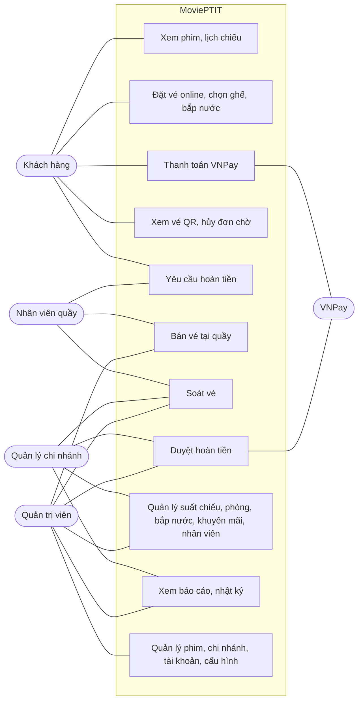

# Tổng quan nghiệp vụ

> Đối chiếu mã nguồn ngày 2026-11-21, commit `4319c45`.

## Bài toán

MoviePTIT là hệ thống đặt vé cho một chuỗi rạp có nhiều chi nhánh. Mỗi chi nhánh có nhiều phòng chiếu, mỗi phòng có sơ đồ ghế riêng. Cùng một ghế của cùng một suất có thể được bán ở hai kênh: khách tự đặt online và nhân viên bán tại quầy. Hệ thống phải bảo đảm một ghế không bị bán hai lần, tiền thu được khớp với vé đã xuất, và mỗi chi nhánh chỉ quản lý dữ liệu của mình.

## Người dùng

| Nhóm | Vai trò trong hệ thống | Mục tiêu chính |
| --- | --- | --- |
| Khách hàng | `USER` | Xem phim và lịch chiếu, đặt vé, thanh toán VNPay, nhận vé QR, hủy đơn chưa thanh toán, yêu cầu hoàn tiền, đánh giá phim. |
| Nhân viên quầy | `STAFF` | Bán vé tại quầy (tiền mặt hoặc VNPay), soát vé, tra cứu đơn, theo dõi doanh thu và đối soát tiền mặt trong ngày. |
| Quản lý chi nhánh | `MANAGER` | Quản lý suất chiếu, phòng, nhân viên, bắp nước, khuyến mãi và hoàn tiền của chi nhánh mình, xem báo cáo chi nhánh. |
| Quản trị viên | `ADMIN` | Quản trị toàn hệ thống: phim, chi nhánh, tài khoản, cấu hình, báo cáo toàn chuỗi. Có thể bán vé và soát vé như nhân viên. |

Ai được làm gì ở phạm vi nào nằm trong [roles-permissions.md](roles-permissions.md).

Ca sử dụng chính (nguồn: [use-case.mmd](../03-architecture/diagrams/use-case.mmd)):

Nhân viên gửi yêu cầu hoàn thay khách cho đơn bán tại quầy. Quản lý có quyền soát vé ở backend nhưng giao diện chưa có trang riêng.

## Chức năng

| Nhóm | Chức năng |
| --- | --- |
| Khám phá | Danh sách phim đang chiếu và sắp chiếu, chi tiết phim kèm trailer và đánh giá, lịch chiếu theo chi nhánh và ngày. |
| Tài khoản | Đăng ký, đăng nhập bằng mật khẩu hoặc Google, quên mật khẩu qua OTP email, hồ sơ cá nhân, hạng thành viên. |
| Đặt vé online | Chọn ghế theo thời gian thực, thêm bắp nước, áp mã khuyến mãi, thanh toán VNPay, nhận vé QR qua email và trong trang "Vé của tôi". |
| Bán vé tại quầy | Chọn suất, chọn ghế, tìm hoặc tạo khách, thu tiền mặt hoặc tạo QR VNPay, in phiếu. |
| Soát vé | Quét QR bằng camera, tải ảnh QR hoặc nhập mã đơn, ghi người và thời điểm soát. |
| Hoàn tiền | Khách gửi yêu cầu trong thời hạn, quản lý duyệt hoặc từ chối, hoàn qua VNPay hoặc xác nhận hoàn tiền mặt. |
| Danh mục | Phim, thể loại, đạo diễn, chi nhánh, phòng, sơ đồ ghế, suất chiếu, bắp nước và tồn kho, khuyến mãi. |
| Vận hành | Dashboard nhân viên, dashboard quản trị, báo cáo doanh thu và vận hành (xuất XLSX), danh sách đơn (xuất XLSX), thông báo, nhật ký thao tác, cấu hình hệ thống. |

Vòng đời một đơn từ lúc giữ ghế tới check-in nằm trong [booking-lifecycle.md](booking-lifecycle.md). Thanh toán và hoàn tiền nằm trong [payment-refund.md](payment-refund.md). Khuyến mãi và hạng thành viên nằm trong [promotion-membership.md](promotion-membership.md).

## Phạm vi

Hệ thống làm:

- Bán vé cho suất chiếu có giá vé chung cho cả suất. Mỗi vé chụp lại giá tại thời điểm tạo suất.
- Thanh toán online duy nhất qua VNPay (sandbox), thanh toán tại quầy bằng tiền mặt hoặc VNPay.
- Hoàn toàn bộ số tiền của đơn. Đơn VNPay hoàn tự động qua API VNPay, đơn tiền mặt do nhân viên xác nhận đã trả tiền.
- Quản lý tồn kho bắp nước ở mức trừ khi đặt và hoàn khi hủy.

Hệ thống không làm:

- Giá vé theo loại ghế. Ghế `VIP` và `COUPLE` hiện cùng giá với ghế thường của suất đó.
- Hoàn một phần đơn, đổi vé sang suất khác, hoàn tiền tự động cho phương thức khác VNPay.
- Ca làm việc, lịch trực, bàn giao ca, chấm công. Các chức năng này đã bị gỡ.
- Trang quản lý tồn kho riêng hay lịch sử nhập xuất kho.
- Thông báo đẩy qua điện thoại hay SMS. Thông báo chỉ hiện trong ứng dụng, vé gửi qua email.

## Tham số nghiệp vụ

ADMIN chỉnh các giá trị này ở `/admin/settings` (bảng `system_settings`). Backend đọc giá trị mới ở mỗi request, không cần khởi động lại. Giá trị nhỏ hơn 1 được nâng lên 1.

| Khóa | Mặc định | Ý nghĩa |
| --- | --- | --- |
| `booking.holdMinutes` | `6` | Số phút giữ ghế cho đơn chờ thanh toán. |
| `booking.maxTicketsPerTransaction` | `8` | Số vé tối đa trong một đơn. |
| `booking.maxPendingPerUser` | `2` | Số đơn chờ thanh toán còn hạn tối đa của một khách. |
| `refund.windowHours` | `24` | Số giờ, tính từ lúc thanh toán, khách được gửi yêu cầu hoàn. |
| `cinema.supportEmail` | `support@movieptit.vn` | Email hỗ trợ hiển thị cho khách. |
| `cinema.supportHotline` | `1900 0000` | Hotline hỗ trợ. |

Các giá trị cố định trong code (đổi cần sửa code):

| Giá trị | Mức | Nơi định nghĩa |
| --- | --- | --- |
| Khoảng đệm giữa hai suất cùng phòng | 15 phút | `ShowtimeService.CLEANUP_BUFFER_MINUTES` |
| Quầy bán tiếp sau giờ chiếu | 15 phút | `BookingCheckoutService.STAFF_SALE_GRACE_MINUTES`, khớp `isShowtimeAvailable` ở `StaffBookingPage.jsx` |
| Mở soát vé trước giờ chiếu | 60 phút | `TicketService.CHECK_IN_OPENS_MINUTES_BEFORE` |
| Số lượng tối đa mỗi món bắp nước | 50 | `CreateBookingFoodRequest.MAX_QUANTITY`, frontend `MAX_FOOD_QUANTITY` |
| Ngưỡng báo sắp hết hàng mặc định | 10 | `FoodStockService.DEFAULT_LOW_STOCK_THRESHOLD` |
| Ngưỡng hạng thành viên | 0 / 500.000 / 2.000.000 / 5.000.000 đ | `MembershipTier` |

> [!NOTE]
> Thông báo lỗi `MAX_TICKET_PER_TRANSACTION` và `REFUND_WINDOW_EXPIRED` đang ghi cứng "8 tickets" và "24 hours". Khi đổi tham số, nội dung thông báo không đổi theo.

## Thông báo trong ứng dụng

| Loại | Khi nào phát sinh | Người nhận |
| --- | --- | --- |
| `REFUND_REQUEST` | Khách hoặc nhân viên gửi yêu cầu hoàn, hoặc VNPay báo thanh toán sau khi đơn đã hết hạn | ADMIN, và MANAGER của chi nhánh có suất chiếu |
| `LOW_STOCK` | Tồn một món vừa xuống tới ngưỡng, hoặc về 0 | ADMIN, và MANAGER của chi nhánh có món đó |
| `BOOKING_STATUS`, `PROMOTION`, `SYSTEM` | Có trong enum, hiện chưa có luồng nào tạo | — |

Trạng thái đã đọc lưu theo từng người. Một nhân viên đọc thông báo chung của chi nhánh không làm người khác thấy thông báo đó đã đọc.

## Công việc tự động

| Công việc | Chu kỳ | Tác dụng |
| --- | --- | --- |
| Dọn đơn hết hạn (`BookingCleanupJob`) | 120 giây | Hủy đơn PENDING quá `expiresAt`, trả ghế, bắp nước và lượt khuyến mãi. |
| Đóng suất chiếu (`ShowtimeService.autoCloseExpiredShowtimes`) | 5 phút | Chuyển suất OPEN đã qua giờ kết thúc sang CLOSED. |
| Cập nhật trạng thái phim (`DataConsistencyJob`) | Mỗi giờ | UPCOMING → NOW_SHOWING khi tới `releaseDate`, → ENDED khi qua `endDate`. Chỉ đi tới và chỉ với phim có ngày, nên không ghi đè quyết định thủ công. |
| Đối soát chi tiêu (`DataConsistencyJob`) | 03:00 hằng ngày | So `users.total_spending` với tổng các đơn đã cộng, ghi log WARN tài khoản lệch, không tự sửa. |
