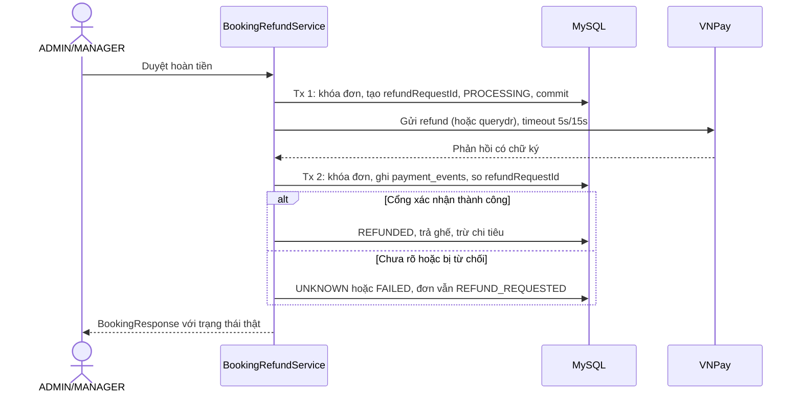

# Thanh toán và hoàn tiền

> Đối chiếu mã nguồn ngày 2026-11-21, commit `4319c45`.

Trạng thái `Booking`, `Ticket` và `Payment` được vẽ trong [booking-lifecycle.md](booking-lifecycle.md#trạng-thái). Cách cấu hình và ký với VNPay nằm trong [vnpay.md](../06-integrations/vnpay.md). File này mô tả quy tắc nghiệp vụ.

## Số tiền của đơn

Backend tính `totalAmount` khi tạo đơn và lưu vào `Payment.amount`. Frontend chỉ hiển thị giá trị này. Cách tính tổng nằm trong [promotion-membership.md](promotion-membership.md#thứ-tự-tính-giá). Mọi giao dịch VNPay, kể cả hoàn tiền, dùng số tiền đã lưu ở `Payment`, không dùng số tiền client gửi lên.

## Thanh toán online qua VNPay

### Tạo URL thanh toán

`POST /v1/vnpay/payment-url` với `bookingId`. Backend chỉ tạo URL khi:

- Người gọi là chủ đơn, người bán đơn tại quầy, hoặc ADMIN.
- Đơn `PENDING`, payment `PENDING` và `expiresAt` chưa qua.

Backend đặt `paymentMethod = VNPAY`, ghi `paymentCreatedAt` nếu chưa có, rồi ký URL. `vnp_TxnRef` là ID đơn, `vnp_CreateDate` là `paymentCreatedAt` để các lệnh truy vấn và hoàn tiền sau này dùng lại đúng mốc, `vnp_ExpireDate` là `expiresAt`. Sau khi URL được cấp, không thể đổi mã khuyến mãi nữa vì số tiền đã được ký.

### Return và IPN

VNPay báo kết quả theo hai đường, cả hai đi qua cùng một hàm xử lý nên kết quả giống nhau và chỉ ghi nhận một lần:

| Đường | Ai gọi | Phản hồi |
| --- | --- | --- |
| Return URL | Trình duyệt quay về `/payment/vnpay-return`, frontend gửi nguyên query string tới `GET /v1/vnpay/return` | `ApiResponse` với `code` 200 nếu đã ghi nhận thanh toán, 97 nếu sai chữ ký, 99 nếu không thành công. `result.paymentApplied` cho biết vé đã được xuất. |
| IPN | Máy chủ VNPay gọi `GET /v1/vnpay/ipn` | `{RspCode, Message}` theo đặc tả VNPay. |

Backend luôn kiểm tra chữ ký, sau đó tìm đơn theo `vnp_TxnRef` và so `vnp_Amount` với số tiền đã lưu. Mọi callback, kể cả sai chữ ký, được ghi vào `payment_events`.

| Tình huống | Xử lý | `RspCode` IPN |
| --- | --- | --- |
| Sai chữ ký | Không đổi gì | `97` |
| Không tìm thấy đơn | Không đổi gì | `01` |
| Sai số tiền | Không đổi gì | `04` |
| Payment đã `PAID` (callback lặp lại) | Không đổi gì, trả kết quả cũ | `02` |
| Thành công, đơn `PENDING` và ghế còn giữ cho đơn | Booking `COMPLETED`, Payment `PAID`, lưu `providerTxnId` và `paidAt`, vé `BOOKED` kèm QR, nhả khóa Redis và phát trạng thái ghế sau commit, phát `BookingPaidEvent` | `00` |
| Thành công nhưng đơn đã hủy hoặc mất ghế | [Thanh toán trễ](#thanh-toán-trễ) | `00` |
| Thành công nhưng đơn ở trạng thái khác (ví dụ `REFUNDED` mà payment chưa `PAID`) | Không ghi đè | `02` |
| Thất bại, đơn còn hạn và còn giữ ghế | Booking và Payment `CANCELLED`, trả ghế, bắp nước, lượt khuyến mãi | `00` |
| Thất bại, đơn đã hết hạn hoặc đã hủy | Không đổi gì, job dọn dẹp hoặc lệnh hủy đã trả tài nguyên | `02` |

"Thành công" nghĩa là cả `vnp_ResponseCode` và `vnp_TransactionStatus` đều là `00`.

### Thanh toán trễ

VNPay chỉ cho khách trả trước `vnp_ExpireDate`, nhưng IPN có thể tới sau khi job đã hủy đơn, hoặc ghế đã bị người khác đặt. Lúc đó tiền đã bị trừ nên hệ thống không được bỏ qua. `recordLatePayment`:

1. Trả tài nguyên còn lại nếu đơn vẫn `PENDING`.
2. Lưu `providerTxnId`, Payment `PAID`, `paidAt`.
3. Đặt Booking `REFUND_REQUESTED`, lý do hoàn `LATE_PAYMENT_REFUND_REASON`, `refundAmount` bằng số tiền đơn, `spendingRecorded = false` (đơn không được cộng vào chi tiêu).
4. Gửi thông báo `REFUND_REQUEST` cho ADMIN và MANAGER chi nhánh.
5. Trả `00` cho VNPay. Trang kết quả hiển thị "Thanh toán đến sau khi đơn đã hết thời gian giữ ghế nên không xuất vé".

Đơn này đi tiếp qua luồng duyệt hoàn tiền bình thường.

## Thanh toán tại quầy

- **Tiền mặt**: đơn hoàn tất ngay khi tạo, `paidAt` là thời điểm tạo, phát `BookingPaidEvent`. Màn quầy cho nhập số tiền khách đưa để tính tiền thừa. Phần này chỉ tính trên trình duyệt.
- **VNPay**: đơn `PENDING` như đơn online. Màn quầy gọi `payment-url` với tư cách người bán, hiện QR của liên kết cho khách quét hoặc mở cổng ở tab mới. "Hủy giao dịch" hủy đơn và trả ghế nhưng giữ lại thông tin đang soạn để nhân viên đổi sang tiền mặt.

Trên localhost, URL trả về của VNPay chỉ mở được trên chính máy chạy frontend, nên khi thử ở quầy hãy dùng nút mở cổng thay vì quét QR bằng điện thoại.

### Đối soát tiền mặt tại quầy

Dashboard nhân viên (`GET /staff/dashboard`) tính cho nhân viên đang đăng nhập, theo ngày rạp:

| Chỉ số | Cách tính |
| --- | --- |
| `cashCollected` | Tổng đơn tiền mặt nhân viên bán và thanh toán hôm nay, kể cả đơn được hoàn sau đó |
| `cashRefunded` | Tổng đơn tiền mặt của nhân viên được hoàn hôm nay, kể cả đơn bán ngày trước |
| `cashExpected` | `cashCollected − cashRefunded` |

Tiền hoàn được tính cho người bán vì hệ thống không ghi ai là người đưa tiền mặt lại cho khách. Tiền lẻ đầu ca và tiền đếm được do nhân viên nhập, chỉ lưu ở localStorage theo ngày rạp, không gửi lên backend.

## Yêu cầu hoàn tiền

`POST /booking/{id}/refund-request` với `reason`. Điều kiện (`RefundPolicy.requireCanRequest`):

- Người gửi là chủ đơn. Với đơn bán tại quầy, ADMIN hoặc STAFF/MANAGER cùng chi nhánh được gửi thay khách, vì khách vãng lai không đăng nhập được. Khi gửi thay phải có lý do (`REFUND_REASON_REQUIRED`) và hệ thống ghi nhật ký `REFUND_REQUESTED`.
- Đơn `COMPLETED`, payment `PAID`, chưa vé nào được check-in.
- Chưa quá hạn: `now ≤ paidAt + refund.windowHours` (mặc định 24 giờ). Quá hạn trả `REFUND_WINDOW_EXPIRED`. Đơn đã hoàn trả `BOOKING_ALREADY_REFUNDED`.

Hạn hoàn được tính từ lúc thanh toán, không phải từ giờ chiếu. API đọc đơn trả sẵn `refundDeadline` cho đơn còn đủ điều kiện. Frontend dùng giá trị này để hiện hoặc ẩn nút "Yêu cầu hoàn", không tự cộng 24 giờ.

Sau khi gửi, đơn chuyển `REFUND_REQUESTED`, `refundAmount` bằng tổng tiền đơn, ADMIN và MANAGER chi nhánh nhận thông báo `REFUND_REQUEST`.

## Duyệt hoặc từ chối

ADMIN, hoặc MANAGER của chi nhánh có suất chiếu, gọi `POST /booking/{id}/refund-process` (`{approved, note}`). `POST /booking/{id}/refund-decision` là route tương đương có validate body. Tài khoản xử lý phải còn ACTIVE. Lúc duyệt, backend không áp lại hạn gửi yêu cầu của khách.

| Quyết định | Điều kiện | Kết quả |
| --- | --- | --- |
| Từ chối | Không có lần hoàn VNPay đang `PROCESSING` hoặc `UNKNOWN` | Booking về `COMPLETED`, xóa lý do, `refundAmount = 0`, ghi `REFUND_REJECTED`. |
| Duyệt, đơn `CASH` | Đơn `REFUND_REQUESTED`, payment `PAID`, chưa check-in | Coi như đã trả tiền mặt tại quầy, [hoàn tất](#khi-hoàn-tất) ngay. |
| Duyệt, đơn `VNPAY` | Như trên, thêm `providerTxnId`, `paidAt`, `paymentCreatedAt` có giá trị và số tiền khớp | Gửi lệnh hoàn qua VNPay. Xem mục dưới. |
| Duyệt, phương thức khác | — | `INVALID_PAYMENT_STATUS`. Chưa hỗ trợ hoàn tự động. |
| Duyệt đơn đã `REFUNDED` | — | Trả kết quả hiện tại, không hoàn lần nữa. |

Người xử lý và ghi chú được lưu từ lúc gửi lệnh (`refundProcessedBy`, `refundProcessedAt`, `refundProcessNote`). Các trường này không có nghĩa là tiền đã hoàn. Chỉ `refundedAt` mới là thời điểm hoàn tất.

### Hoàn qua VNPay

Gọi mạng tới VNPay có thể chậm, lỗi hoặc không rõ kết quả. Để không hoàn hai lần và không giữ khóa DB trong lúc chờ, `BookingRefundService` chia làm ba bước (lý do trong [ADR-0006](../08-decisions/0006-refund-commit-before-gateway.md)):

Chỉ khi phản hồi có chữ ký hợp lệ, đúng merchant, đúng đơn, đúng số tiền, loại hoàn toàn phần `02`, `vnp_ResponseCode = 00`, `vnp_TransactionStatus = 00` và có mã giao dịch mới thì mới coi là thành công. HTTP 200 hay một mình `ResponseCode = 00` chưa đủ.

### Trạng thái lần hoàn qua VNPay

`Payment.refundGatewayStatus` mô tả lần thử gần nhất:

| Trạng thái | Nghĩa | Bấm duyệt lại thì |
| --- | --- | --- |
| `PROCESSING` | Đang có một request gọi cổng | Dưới 60 giây: trả trạng thái đang chờ. Quá 60 giây (ví dụ server crash giữa chừng): truy vấn kết quả. |
| `UNKNOWN` | Timeout, phản hồi không xác thực được, mã trùng hoặc cổng báo đang xử lý | Chỉ truy vấn (`querydr`), không gửi thêm lệnh hoàn. |
| `FAILED` | Cổng từ chối rõ ràng, có xác thực | Gửi lệnh hoàn mới với `refundRequestId` mới. |
| `SUCCEEDED` | Cổng xác nhận | Đơn đã `REFUNDED`. |

Kết quả truy vấn chỉ nói về giao dịch thanh toán gốc (loại `01`) không được coi là xác nhận hoàn. Nếu cổng không cung cấp xác nhận, đơn tiếp tục chờ và cần đối soát với VNPay. Không tự sửa marker để gửi lại. Phản hồi của một lần thử cũ tới muộn chỉ được ghi vào `payment_events`, không ghi đè lần thử mới.

Giao diện quản lý chỉ báo thành công khi đơn trả về `REFUNDED`. Với `PROCESSING` hoặc `UNKNOWN`, trang hiện `refundGatewayMessage`, khóa nút từ chối và đổi nút duyệt thành "Kiểm tra kết quả".

### Khi hoàn tất

Trong một transaction:

- Booking `REFUNDED`, Payment `REFUNDED`, ghi `refundedAt` và `refundAmount`.
- Trả ghế về `AVAILABLE` (`releaseSeats`). Không cộng lại tồn bắp nước, không trả lượt khuyến mãi đã dùng.
- Trừ tổng chi tiêu của khách và tính lại hạng, trừ khi `spendingRecorded = false` (thanh toán trễ chưa từng được cộng).
- Ghi nhật ký `REFUND_APPROVED`. Phát trạng thái ghế sau commit.

Nếu có vé đã check-in, hoàn tất bị chặn với `BOOKING_CANNOT_REFUND`.

### API hoàn tiền trực tiếp

`POST /v1/vnpay/refund` và `POST /v1/vnpay/querydr` dành cho ADMIN và MANAGER đúng chi nhánh, nhận `orderId` (ID hoặc mã đơn). Hoàn trực tiếp đi qua cùng `BookingRefundService`. Để tương thích với client cũ, DTO vẫn có `amount`, `trantype`, `user`, `transDate`: `amount` phải khớp số tiền đã lưu, `trantype` phải là `02` (hoàn toàn phần), còn `user` và `transDate` bị bỏ qua. `result` trả tên trạng thái booking sau khi xử lý.

## Trường hợp lỗi

| Tình huống | Hệ thống xử lý |
| --- | --- |
| IPN tới sau `expiresAt`, ghế còn giữ | Vẫn xuất vé. |
| IPN tới sau khi đơn bị hủy | Thanh toán trễ, chờ hoàn. |
| IPN và return URL cùng tới | Lần sau nhận `02`, không ghi nhận hai lần. |
| Khách đóng trình duyệt trên trang VNPay | IPN vẫn cập nhật đơn. Không có IPN thì job hủy đơn khi hết hạn. |
| VNPay timeout khi hoàn | `UNKNOWN`, bấm lại để truy vấn. |
| Server dừng giữa lúc gọi cổng hoàn | Marker `PROCESSING` còn lại. Sau 60 giây, bấm lại để truy vấn. |
| Gửi email vé thất bại | Ghi log, đơn vẫn hoàn tất. Email chạy sau commit. |

## Dữ liệu từ phiên bản cũ

- Đơn `REFUNDED` từ trước khi có marker lần hoàn (`refundRequestId` null) không phải bằng chứng VNPay đã hoàn tiền. Cần đối soát riêng, không gửi lại hàng loạt.
- URL thanh toán phát sinh trước khi dùng `paymentCreatedAt` cho `vnp_CreateDate` có thể mang mốc thời gian khác giá trị đã lưu. Khi truy vấn hoặc hoàn những đơn này, đối chiếu thời gian giao dịch gốc trên cổng VNPay.
