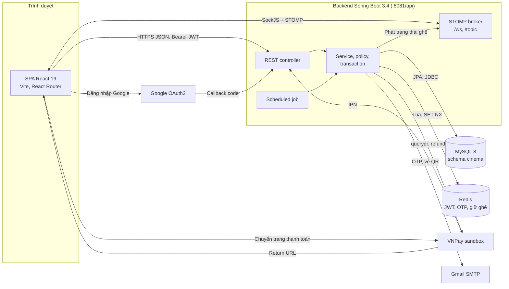

# Tổng quan kiến trúc

> Đối chiếu mã nguồn ngày 2026-11-25, nhánh `fix/backend-review-cleanup` (tách từ commit `7105c25`).

MoviePTIT gồm một SPA React và một ứng dụng Spring Boot. Hai phần chạy độc lập, nói chuyện qua REST và WebSocket. Backend là nơi duy nhất quyết định quyền, giá, trạng thái ghế và tiền.

## Sơ đồ khối

Nguồn: [diagrams/system-context.mmd](diagrams/system-context.mmd).

## Thành phần

| Thành phần | Công nghệ | Trách nhiệm | Chi tiết |
| --- | --- | --- | --- |
| Frontend | React 19, Vite 8, React Router 7, Axios, STOMP/SockJS | Giao diện khách, quầy và quản trị. Gắn JWT, làm mới token, hiển thị trạng thái do backend trả về. | [frontend.md](frontend.md) |
| Backend | Java 21, Spring Boot 3.4.0, Spring Security, JPA, MapStruct | REST API, xác thực, phân quyền, nghiệp vụ đặt vé, thanh toán, báo cáo, job định kỳ, phát sự kiện ghế. | [backend.md](backend.md) |
| MySQL 8 | Schema `cinema`, Flyway | Nguồn dữ liệu chính. Khóa dòng khi đặt vé, ràng buộc CHECK và khóa ngoại. | [05-database](../05-database/erd.md) |
| Redis | Spring Data Redis, `StringRedisSerializer` | Trạng thái ngắn hạn có TTL. Không phải nguồn dữ liệu chính. | Bảng dưới |
| VNPay sandbox | HMAC-SHA512 | Thanh toán, truy vấn giao dịch, hoàn tiền. | [vnpay.md](../06-integrations/vnpay.md) |
| Google | OAuth2 / OpenID Connect | Đăng nhập bằng tài khoản Google. | [google-oauth.md](../06-integrations/google-oauth.md) |
| Gmail SMTP | Spring Mail, ZXing | Gửi OTP và vé kèm mã QR. | [email.md](../06-integrations/email.md) |

## Kênh giao tiếp

| Từ → tới | Giao thức | Điểm vào |
| --- | --- | --- |
| SPA → backend | HTTP JSON, header `Authorization: Bearer <access token>` | `${VITE_API_BASE_URL}`, mặc định `http://localhost:8081/api`. Không có proxy Vite, backend bật CORS. Xem [conventions.md](../04-api/conventions.md). |
| Backend → SPA | STOMP qua SockJS | Endpoint `/api/ws`, topic `/topic/showtime/{showtimeId}/seats`. Xem [realtime.md](../04-api/realtime.md). |
| VNPay → backend | HTTP GET, tham số có chữ ký | `/api/v1/vnpay/ipn` |
| VNPay → SPA → backend | Chuyển trang, rồi SPA gửi lại query string | `/payment/vnpay-return` → `/api/v1/vnpay/return` |
| Backend → VNPay | HTTP POST JSON | `vnpay.api-url`, timeout kết nối 5 giây, đọc 15 giây |
| Google → backend | OAuth2 authorization code | `/api/login/oauth2/code/google` |
| Backend → SPA (sau Google) | Chuyển trang, token trong fragment URL | `/oauth2/callback#accessToken=...&refreshToken=...` |

## Vai trò của Redis

| Key | Giá trị | TTL | Dùng cho |
| --- | --- | --- | --- |
| `auth:refresh:active:{jti}` | username | Tới khi refresh token hết hạn (30 ngày) | Phiên refresh còn hiệu lực. Refresh dùng Lua compare-and-delete nên mỗi token chỉ dùng được một lần. Xem [ADR-0001](../08-decisions/0001-refresh-token-redis-single-use.md). |
| `auth:access:revoked:{jti}` | `1` | Tới khi access token hết hạn (30 phút) | Danh sách access token đã đăng xuất. |
| `otp:code:{email}` | OTP 6 chữ số | 5 phút | Quên mật khẩu. |
| `otp:limit:{email}` | Bộ đếm | 1 phút, đặt lại sau mỗi lần tăng | Từ chối khi vượt 5 lần gửi OTP. |
| `seat_hold:{showtimeId}:{seatId}` | Mã đơn đang giữ | `booking.holdMinutes` (mặc định 6 phút) | Giữ ghế. Chỉ đơn sở hữu mới xóa được. Xem [ADR-0002](../08-decisions/0002-seat-hold-redis-and-db-lock.md). |

Ứng dụng không dùng Redis làm cache (không có `@EnableCaching` hay `@Cacheable`). Mất dữ liệu Redis làm mọi người phải đăng nhập lại và mất khóa giữ ghế đang có. DB vẫn giữ trạng thái `HOLDING` của vé cho tới khi job dọn đơn hết hạn.

## Luồng liên tầng

| Luồng | Mô tả ở |
| --- | --- |
| Đăng nhập, refresh, đăng xuất | [conventions.md](../04-api/conventions.md#xác-thực), [frontend.md](frontend.md#xác-thực-và-gọi-api) |
| Tìm suất, chọn ghế, đặt vé online | [booking-lifecycle.md](../02-domain/booking-lifecycle.md#đặt-vé-online) |
| Thanh toán VNPay, return, IPN | [payment-refund.md](../02-domain/payment-refund.md#thanh-toán-online-qua-vnpay) |
| Bán vé tại quầy | [booking-lifecycle.md](../02-domain/booking-lifecycle.md#bán-tại-quầy) |
| Hủy và hết hạn | [booking-lifecycle.md](../02-domain/booking-lifecycle.md#hủy-và-hết-hạn) |
| Check-in | [booking-lifecycle.md](../02-domain/booking-lifecycle.md#check-in) |
| Hoàn tiền | [payment-refund.md](../02-domain/payment-refund.md#duyệt-hoặc-từ-chối) |
| Cập nhật hạng sau thanh toán, gửi vé | [promotion-membership.md](../02-domain/promotion-membership.md#cập-nhật-sau-thanh-toán), [email.md](../06-integrations/email.md) |

## Thời gian

Mọi mốc nghiệp vụ dùng giờ rạp `Asia/Ho_Chi_Minh` (UTC+7, không có giờ mùa hè):

- Backend inject một `Clock` duy nhất từ `TimeConfig` cho đặt vé, thanh toán, hoàn tiền, check-in, job, JWT, khuyến mãi, suất chiếu, thông báo và báo cáo.
- Kết nối MySQL chạy `SET time_zone = '+07:00'`, nên `CURRENT_TIMESTAMP` trong DEFAULT và `ON UPDATE` cũng là giờ rạp kể cả khi MySQL server chạy UTC.
- Backend lưu và trả `LocalDateTime` không kèm múi giờ. Frontend hiểu các giá trị này là giờ rạp qua `src/utils/cinemaTime.js`, không dùng `new Date(chuỗi)` vì hàm đó dùng múi giờ của máy.

Một số chỗ cũ vẫn gọi `LocalDateTime.now()` không qua `Clock`, ví dụ `@PrePersist` của `User` và `DataSeeder`. Các chỗ này không ảnh hưởng nghiệp vụ khi máy chủ chạy giờ Việt Nam.
