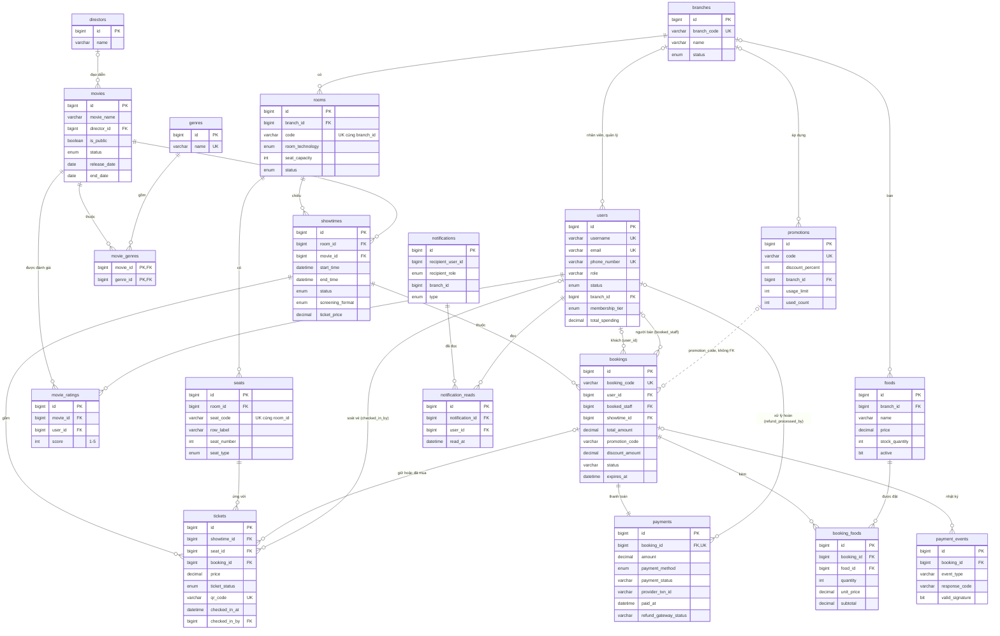

# Sơ đồ quan hệ thực thể

> Đối chiếu mã nguồn ngày 2026-11-21, commit `4319c45` (schema sau Flyway V7).

Schema `cinema` trên MySQL 8, mọi bảng dùng InnoDB và `utf8mb4_unicode_ci`. Sơ đồ chỉ ghi khóa và cột chính. Toàn bộ cột nằm trong [data-dictionary.md](data-dictionary.md). Nguồn sơ đồ để xuất ảnh: [erd.mmd](../03-architecture/diagrams/erd.mmd).

Hai bảng không có quan hệ khóa ngoại nên không có trong sơ đồ: `audit_logs` (lưu `actor_id`, `branch_id` dạng số để nhật ký tồn tại độc lập với dữ liệu gốc) và `system_settings`.

## Các quan hệ quan trọng

**Suất chiếu sinh sẵn vé.** `tickets` có một dòng cho mỗi cặp (suất, ghế), ràng buộc duy nhất `(showtime_id, seat_id)`. Vé tồn tại từ lúc tạo suất, `booking_id` null nghĩa là ghế còn trống. Đặt vé là khóa và cập nhật các dòng này, không phải chèn dòng mới. Nhờ vậy, hai người không thể mua cùng một ghế. Vé không bị xóa khi đơn hủy hay hoàn, chỉ được gỡ khỏi đơn.

**`bookings` – `payments` một-một.** `payments.booking_id` là `UNIQUE` và `ON DELETE CASCADE`. Entity `Booking` tự tạo `Payment` khi lưu, nên mọi đơn luôn có một dòng payment. Lý do tách bảng ở [ADR-0003](../08-decisions/0003-separate-payment-from-booking.md). JSON `BookingResponse` vẫn trả các trường thanh toán ở cấp ngoài cùng (`paymentStatus`, `paidAt`, `refundGatewayStatus`...).

**Hai quan hệ từ `bookings` tới `users`.** `user_id` là khách sở hữu đơn. `booked_staff` là nhân viên bán, chỉ có giá trị với đơn tại quầy. Entity gọi trường này là `staffUser`.

**Chi nhánh của dữ liệu.** Phần lớn dữ liệu xác định chi nhánh qua chuỗi `showtimes → rooms → branches`, ví dụ chi nhánh của một đơn là chi nhánh của phòng chiếu. `users.branch_id`, `foods.branch_id`, `promotions.branch_id` trỏ thẳng tới `branches`. Ở `foods` và `promotions`, null nghĩa là dùng cho mọi chi nhánh. Khóa ngoại `RESTRICT` chặn xóa chi nhánh còn nhân viên, món hoặc khuyến mãi, backend trả `RESOURCE_IN_USE`.

**Khuyến mãi gắn bằng mã, không bằng khóa ngoại.** `bookings.promotion_code` lưu chuỗi mã đã áp. Đơn cũ vẫn đọc được khi mã bị tắt.

**Nhật ký thanh toán chặn xóa đơn.** `payment_events.booking_id` có khóa ngoại không cascade. Đơn đã có giao dịch VNPay không xóa được, để dấu vết giao dịch không mất.

**Đã đọc theo từng người.** Một thông báo có thể gửi cho một người (`recipient_user_id`) hoặc một role ở một chi nhánh. Mỗi lần một người đọc là một dòng `notification_reads`, duy nhất theo `(notification_id, user_id)`.
