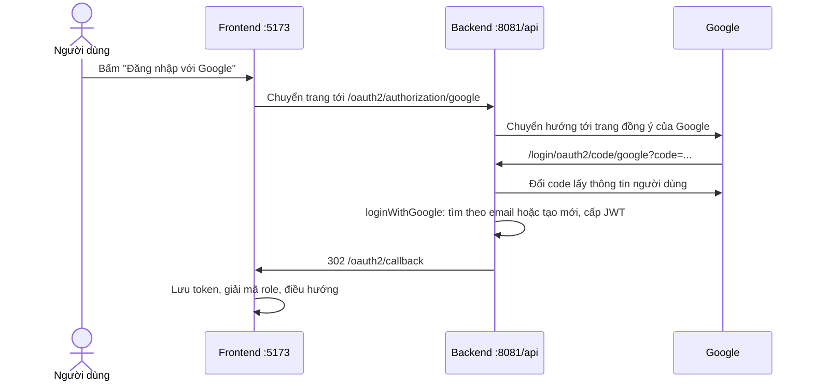

# Đăng nhập Google

> Đối chiếu mã nguồn ngày 2026-11-21, commit `4319c45`.

Backend dùng Spring Security OAuth2 Client (`oauth2Login`) với provider Google, scope `openid`, `profile`, `email`. Sau khi Google xác thực, backend tự cấp cặp JWT như đăng nhập bằng mật khẩu và chuyển trình duyệt về frontend.

| Thành phần | File |
| --- | --- |
| Cấu hình client | `spring.security.oauth2.client.registration.google` trong [application.yaml](../../backend/src/main/resources/application.yaml) |
| Thành công, thất bại | [OAuth2LoginSuccessHandler.java](../../backend/src/main/java/com/ltweb/backend/config/OAuth2LoginSuccessHandler.java), [OAuth2LoginFailureHandler.java](../../backend/src/main/java/com/ltweb/backend/config/OAuth2LoginFailureHandler.java) |
| Tạo hoặc ghép tài khoản | `AuthService.loginWithGoogle` |
| Nút đăng nhập | `authApi.getGoogleLoginUrl()` trong `LoginPage.jsx` |
| Nhận token | `frontend/src/pages/Login/OAuth2CallbackPage.jsx` |

## Tạo OAuth client

1. Vào Google Cloud Console, tạo hoặc chọn một project.
2. **APIs & Services → OAuth consent screen**: chọn loại External, điền tên ứng dụng và email hỗ trợ. Khi ứng dụng ở chế độ Testing, thêm tài khoản Google của từng thành viên vào danh sách Test users.
3. **APIs & Services → Credentials → Create credentials → OAuth client ID**, loại **Web application**.
4. **Authorized redirect URIs**, thêm:

   ```text
   http://localhost:8081/api/login/oauth2/code/google
   ```

   URI này trỏ tới backend (gồm context path `/api`), không trỏ tới frontend. Đổi cổng hoặc domain backend thì phải thêm URI mới.

5. Sao chép Client ID và Client secret vào `backend/.env`:

   ```dotenv
   GOOGLE_CLIENT_ID=<client id>
   GOOGLE_CLIENT_SECRET=<client secret>
   APP_OAUTH2_SUCCESS_URL=http://localhost:5173/oauth2/callback
   APP_OAUTH2_FAILURE_URL=http://localhost:5173/login
   ```

`GOOGLE_CLIENT_SECRET` là bí mật. Thiếu hai biến Google thì backend vẫn chạy với giá trị giả, chỉ riêng nút đăng nhập Google báo lỗi.

## Luồng



- Token được đặt trong **fragment** (`#...`) để không bị gửi lên server hay ghi vào log truy cập. `OAuth2CallbackPage` vẫn đọc được query string kiểu cũ.
- Lỗi ở bất kỳ bước nào chuyển về `APP_OAUTH2_FAILURE_URL?oauth2Error=<thông báo>`.
- Phiên HTTP của Spring chỉ dùng trong lúc trao đổi với Google. Sau khi về frontend, mọi request dùng JWT như bình thường.

## Ghép tài khoản

`AuthService.loginWithGoogle` dùng email Google làm khóa:

| Trường hợp | Kết quả |
| --- | --- |
| Google không trả email | `OAUTH2_EMAIL_MISSING`, đăng nhập thất bại |
| `email_verified = false` | `OAUTH2_EMAIL_NOT_VERIFIED`, đăng nhập thất bại |
| Đã có tài khoản cùng email | Đăng nhập vào tài khoản đó, giữ nguyên role. Chỉ điền `fullName` nếu đang trống. |
| Chưa có tài khoản | Tạo USER mới: `username` lấy phần trước `@` của email (ký tự lạ thành `_`, trùng thì thêm số), mật khẩu ngẫu nhiên, trạng thái ACTIVE |
| Tài khoản `BLOCKED` hoặc `INACTIVE` | `ACCESS_DENIED`, không cấp token |

Hệ quả: một tài khoản ADMIN hay STAFF có email trùng với tài khoản Google sẽ đăng nhập được bằng Google với đúng role đó. Tài khoản tạo qua Google không biết mật khẩu, người dùng có thể đặt mật khẩu bằng chức năng quên mật khẩu.

## Lỗi thường gặp

| Hiện tượng | Cách sửa |
| --- | --- |
| Google báo `redirect_uri_mismatch` | Redirect URI trên Google Cloud phải đúng từng ký tự `http://localhost:8081/api/login/oauth2/code/google` |
| Google báo `access_denied` hoặc "app not verified" | Thêm tài khoản thử vào Test users của OAuth consent screen |
| Quay về `/login?oauth2Error=...` | Đọc thông báo lỗi. Thường do client ID/secret sai hoặc tài khoản bị khóa. |
| Về đúng `/oauth2/callback` nhưng không đăng nhập | Kiểm tra `APP_OAUTH2_SUCCESS_URL` trỏ đúng cổng frontend đang chạy |
